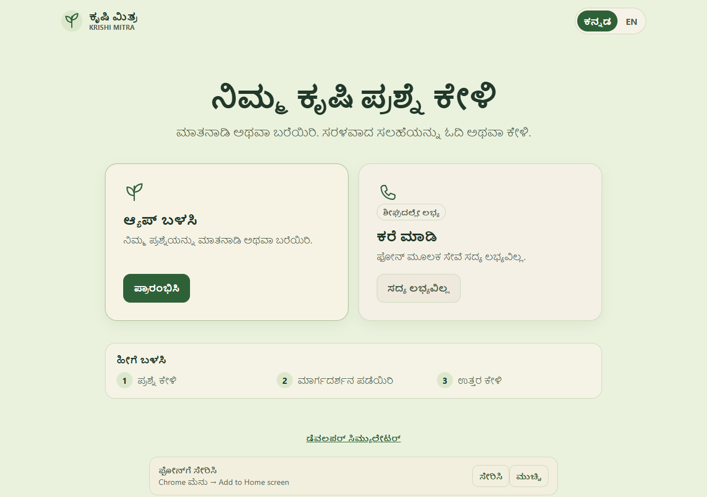
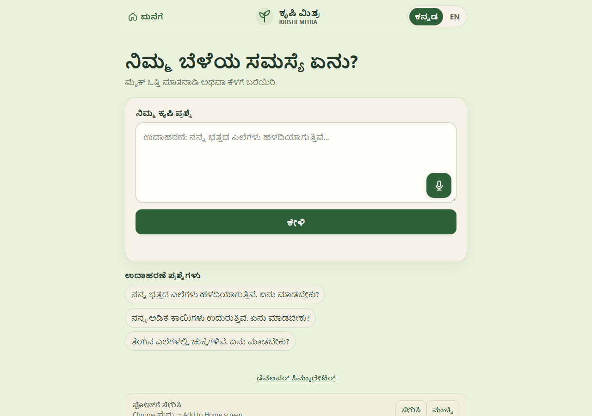
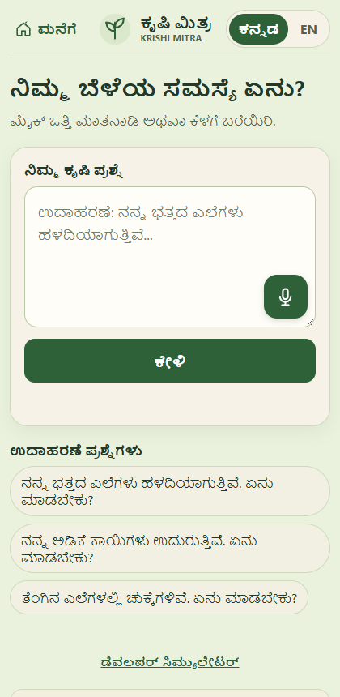
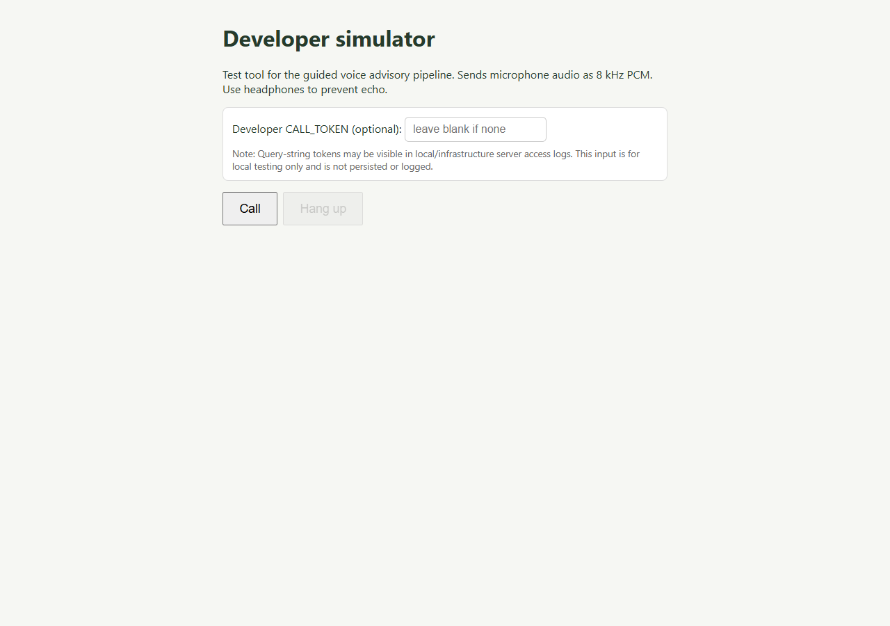

# Krishi Mitra (ಕೃಷಿ ಮಿತ್ರ)

**A Kannada-First Voice & Text Agricultural Companion for Karnataka Farmers**  
*Built for the Gnani AI Great Indian AI Internship Challenge*

---

## 🌐 Live Application Links

- **Landing Page (Home):** <https://krishi-mitra-gn3h.onrender.com/>
- **Ask Krishi Mitra (Web App):** <https://krishi-mitra-gn3h.onrender.com/ask>
- **Developer Voice Simulator:** <https://krishi-mitra-gn3h.onrender.com/sim>
- **GitHub Repository:** <https://github.com/11DDBOY11/Gnani_ai_Competition>

---

## 📸 User Interface Showcase

### 1. Farmer-Facing Landing Page (`/`)
The responsive public landing page introduces Krishi Mitra, provides an instant Kannada/English language toggle, outlines the supported crops and core advisory principles, and directs farmers to the Ask interface.



---

### 2. Ask Krishi Mitra (`/ask`)
A voice-first web application where farmers can speak naturally in Kannada or type their agricultural query. Microphone audio is streamed at 8 kHz phone quality to Gnani AI Vachana STT, transcribed in real time, reasoned via Groq LLM, and synthesized into spoken Kannada using Gnani AI Timbre-v3.0.



#### Mobile Experience
The interface is optimized for mobile touchscreens and features one-click sample questions, instant audio playback with Listen/Stop controls, and responsive layout:

<p align="center">
  
</p>

---

### 3. Developer Guided Voice Simulator (`/sim`)
A browser-based phone simulator built to develop and test the core guided conversational pipeline. It simulates 8 kHz phone-quality PCM audio streaming over WebSockets, slot-filling dialogue state retention, and explicit client-server playback acknowledgements (`ack_mode`).



---

## 🏗️ System Architecture & Workflow

```
[ Farmer Speaks (Kannada) ]
          │ (8 kHz Phone-Quality PCM Stream)
          ▼
[ Gnani AI Vachana STT ] ──► Real-time Kannada Transcription
          │
          ▼
[ Guided Engine & Groq LLM ] ──► Agronomic Reasoning & Safety Filtering
          │
          ▼
[ Gnani AI Timbre-v3.0 TTS ] ──► Clear Kannada Audio Synthesis (Lakshmi)
          │
          ▼
[ Audio Player / Simulator ] ──► Synchronized Playback with Acknowledgements
```

---

## 🚀 Key Features

1. **Voice-First Accessibility:**
   - Farmers who cannot spell or type complex Kannada botanical terms can ask questions completely by voice.
   - Live microphone capture streams 8 kHz phone-quality PCM audio directly to Gnani AI.

2. **Dual-Mode Demonstration:**
   - **Ask Web App (`/ask`):** Open-ended agricultural Q&A with real-time transcription, sample query chips, and spoken playback.
   - **Guided Simulator (`/sim`):** Slot-filling conversational engine focusing on 3 supported crops: **Paddy (ಭತ್ತ)**, **Arecanut (ಅಡಿಕೆ)**, and **Coconut (ತೆಂಗು)**.

3. **Responsible Advisory & Safety Gates:**
   - **Non-Diagnostic:** Provides agronomic guidance without claiming to replace in-person pathology inspections.
   - **Chemical Safety Gate:** Unreviewed chemical trade names and dosages are suppressed from voice synthesis.
   - **Government Helpline Referral:** Farmers with severe or unknown crop issues are referred to the Government of India Kisan Call Centre at **1800-180-1551**.

4. **Robust Audio Sequencing:**
   - Explicit client-server playback acknowledgement (`ack_mode`) prevents audio cutoff.
   - Browser microphone intake is suppressed while spoken responses are actively playing.

---

## 🛣️ Routes

| Route | Purpose |
| :--- | :--- |
| `/` | Farmer-facing landing page |
| `/ask` | Farmer question-and-answer voice & text web app |
| `/sim` | Developer guided voice simulator |
| `/health` | Health check endpoint |
| `/api/agri-search` | Submit typed or transcribed agricultural questions |
| `/api/agri-search/transcribe` | Transcribe captured microphone audio via Gnani AI |
| `/api/agri-search/speak` | Synthesize answer audio for Listen playback via Gnani AI |
| `/ws/call` | Guided simulator WebSocket connection |

---

## 💻 Local Setup

In Windows PowerShell, from the repository root:

```powershell
python -m venv .venv
.venv\Scripts\Activate.ps1
python -m pip install -r requirements.txt
Copy-Item .env.example .env
```

Configure your credentials in `.env`:

```dotenv
GNANI_API_KEY=your_gnani_api_key
GROQ_API_KEY=your_groq_api_key
GROQ_MODEL=openai/gpt-oss-120b
```

> **Security Note:** Keep `.env` private and never commit credentials, tokens, or recordings to version control.

Start the application server:

```powershell
python -m uvicorn app.server:app --reload --port 8000
```

Open in your browser:
- Landing Page: <http://localhost:8000/>
- Ask App: <http://localhost:8000/ask>
- Developer Simulator: <http://localhost:8000/sim>

---

## 🧪 Testing

Run the automated test suite:

```powershell
pytest -q
```

Or run focused test modules:

```powershell
pytest tests/test_landing_routes.py tests/test_agri_search.py tests/test_playback_sync.py -q
```

---

## 🏆 Gnani AI Internship Challenge

Krishi Mitra was designed and built for the **Gnani AI Great Indian AI Internship Challenge**.
